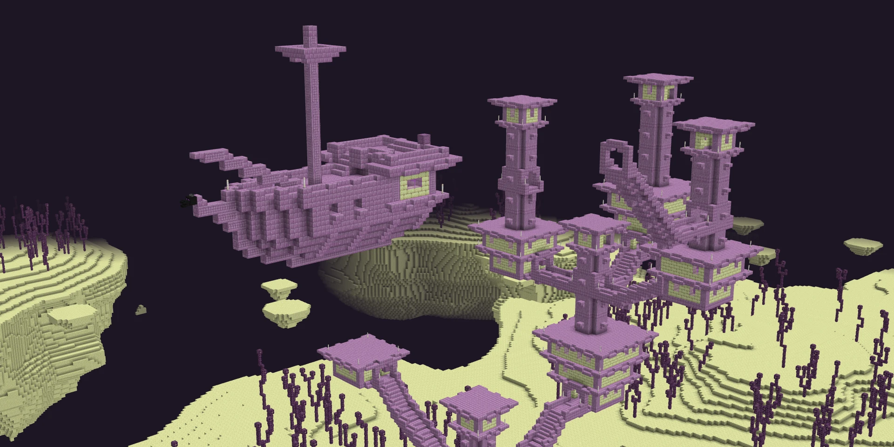
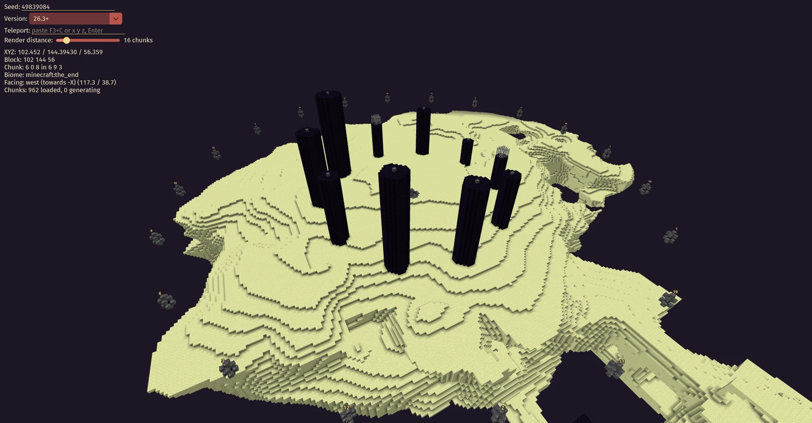

# Kumiko

**explore any minecraft seed in 3d.**

enter a seed and kumiko generates the world exactly as the game would, then lets you fly through it.

> **NOT AN OFFICIAL MINECRAFT PRODUCT. NOT APPROVED BY OR ASSOCIATED WITH MOJANG OR MICROSOFT.**



## Download

download `kumiko.jar` from the [releases page](https://github.com/mimikyumochi/kumiko/releases).

kumiko needs **java 25** or newer.

## Running Kumiko

open a terminal in the folder with `kumiko.jar` and run:

```
java -jar kumiko.jar
```

on macos, run this instead:

```
java -XstartOnFirstThread -jar kumiko.jar
```

the first time it starts, kumiko downloads minecraft's textures from mojang's servers. this is about 41 mb, of which 13 mb is kept in `~/.kumiko/assets`. after that, it works offline.

## Building

if you'd rather build kumiko yourself, you need **jdk 25** and git. gradle downloads everything else.

```
git clone https://github.com/mimikyumochi/kumiko.git
cd kumiko
./gradlew kumikoJar
```

on windows, use `gradlew.bat kumikoJar` instead of `./gradlew kumikoJar`.

this builds `build/dist/kumiko.jar`, which runs the same way as the downloaded one.

to run the tests:

```
./gradlew :core:test :end:test :nether:test
```

## Supported Dimensions

**the end** is fully supported, for every version from 1.13 to 26.3. this includes:

- the terrain and outer islands
- end cities, including their ships and elytra
- all 20 gateways, and the order they open in
- chorus plants

**the nether** has basic support, for every version from 1.16 to 26.3. this includes:

- the terrain and lava sea
- biomes
- caves

it doesn't have surface blocks, features or structures yet, so the terrain is all netherrack.

**the overworld** is planned.



*the main island, with each gateway numbered by the dragon kill that opens it.*

## Controls

| key | action |
| --- | --- |
| wasd | move |
| space / shift | move up / down |
| ctrl | move faster |
| hold right mouse | look around |
| scroll | zoom |
| f1 | hide the overlay |
| f2 | take a screenshot |
| f3 + c | copy a `/tp` command for your position |
| f4 | show the end's exit gateways |

to load a seed, type it into the box in the top-left corner and press enter.

to switch dimension, pick one in the box in the top-left corner.

to go to a spot from your game, press f3 + c in minecraft and paste the command into kumiko's teleport box. f3 + c in kumiko works the other way, so you can paste its command into the game's chat.

## License

kumiko is free software, released under the [gnu general public license v3.0](LICENSE). any version you distribute must stay open source under the same licence. the open-source libraries kumiko includes are listed in [licenses/](licenses/).
